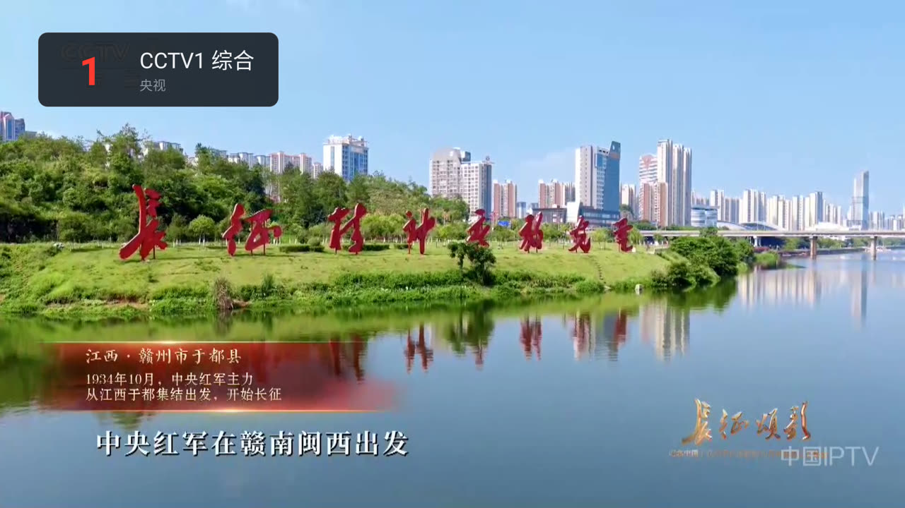
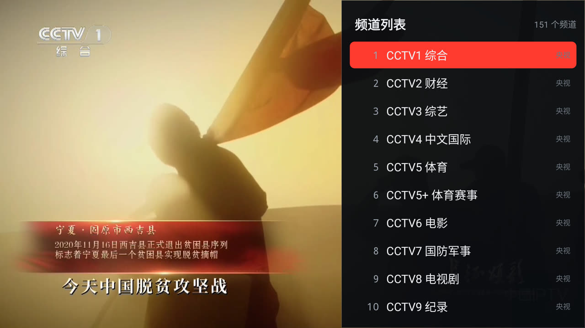
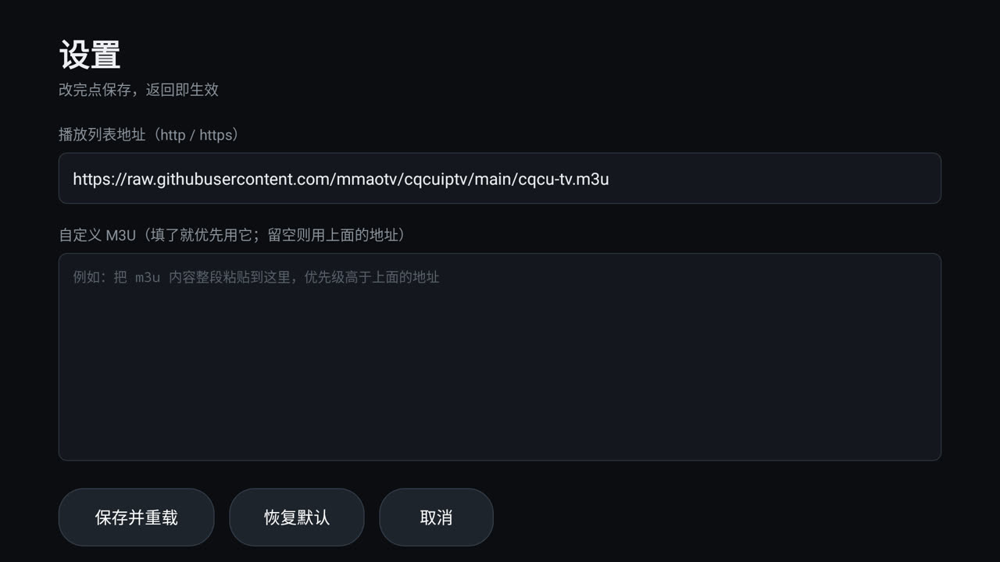

# CQCU-IPTV

适用于重庆联通用户的 IPTV 频道列表，外加一个专门给它用的小电视直播 App。

> ⚠️ 这些直播源只能在 **重庆联通网络** 下播放，其他网络打开会黑屏/超时。

---

## CQCU 直播（这个 App）

一个只有 **53 KB** 的电视直播客户端，为「遥控器 + 数字键」而写：按 `1` 就是 CCTV1，
CCTV 全部排完之后紧接着是湖南卫视等卫视台。



### 特性

- **体积**：约 53 KB，零第三方依赖（不用 AndroidX / ExoPlayer），直接用系统 `MediaPlayer` 解码，
  `rtsp://`、`http://`、`.m3u8` 都交给盒子本身的硬解能力
- **兼容**：minSdk 19，Android 4.4 及以上都能装
- **换台**：数字键直达频道号，上下键依次换台，左右键调音量
- **频道列表**：OK 键呼出右侧抽屉，按当前频道自动定位，选中即换台
- **自定义直播源**：设置页填 m3u 地址，或者把整段 m3u 内容直接粘进去
- **离线可用**：APK 内置一份频道列表，断网/地址失效也能进界面看电视
- **记住上次的台**：重新打开接着上次的频道放

### 截图

| 频道列表（151 个台） | 数字键跳台：按 `1` `8` → 18 台 湖南卫视 |
| --- | --- |
|  |  |



### 遥控器按键

| 按键 | 作用 |
| --- | --- |
| `0`–`9` | 输入频道号，约 1.1 秒后自动跳转（最多 3 位，如 `1` → CCTV1，`1` `8` → 湖南卫视） |
| `↑` / `↓`、`CH+` / `CH-` | 上一个 / 下一个频道 |
| `←` / `→` | 音量 - / + |
| `OK` / `确认` | 打开频道列表；列表里再按 `OK` 换台；播放失败时按 `OK` 重试 |
| `返回` | 关闭频道列表；再按退出 App |
| `MENU` / 长按 `OK` | 打开设置页 |

### 台号是怎么排的

`cqcu-tv.m3u` 是专门为遥控器重排过的列表，台号 = 行号：

| 台号 | 内容 |
| --- | --- |
| 1 – 17 | CCTV1 … CCTV17（CCTV5+ 在第 6 位） |
| 18 起 | 湖南卫视、浙江卫视、江苏卫视、东方卫视、北京卫视…… 各省卫视 |
| 卫视之后 | CCTV 付费频道 / CETV / CHC、重庆本地台、上海、IPTV、影视、其他 |

顺序由 `scripts/build_tv_m3u.py` 生成。想调整（比如把湖南卫视换到 19 位、或把卫视放最后），
改脚本顶部的 `WEISHI_ORDER` / `PAY_ORDER` 再跑一遍即可，每天也会随 CI 自动重建。

### 换直播源

设置页（`MENU` 键）里有两个入口，优先级从高到低：

1. **自定义 M3U**：把 m3u 内容整段粘进去，直接用这份
2. **播放列表地址**：填一个 `http(s)://` 地址，App 启动时拉取（例如放在 NAS / 图床上的 m3u）
3. **内置列表**：上面两个都不生效时，用 APK 里打包的 `cqcu-tv.m3u`

点「保存并重载」立刻生效，「恢复默认」回到仓库里的在线地址。
列表拉不到时底部会提示「离线：正在用内置频道列表」，不影响继续看。

### 安装

- **直接下载**：[Releases](https://github.com/mmaotv/cqcuiptv/releases/latest) 里的 `CQCU-TV-*.apk`
- **adb 安装**：

  ```bash
  adb install -r CQCU-TV-1.0.0.apk
  ```

装好以后在电视桌面上找 **CQCU 直播**（红色播放按钮图标）。

### 自己编译

需要 JDK 17+ 和 Android SDK（compileSdk 34）：

```bash
./gradlew assembleRelease
# 产物：app/build/outputs/apk/release/CQCU-TV-1.0.0.apk
```

想把自己的列表打进 APK 当默认列表，可以覆盖默认地址：

```bash
./gradlew assembleRelease -PdefaultPlaylist=http://192.168.1.10:8000/my.m3u
```

签名用仓库里的 `keystore/cqcuiptv.jks`（密码 `cqcuiptv`，公开自签名，只为保证版本之间能覆盖安装）。
推送到 `main` 后 GitHub Actions 会自动构建并更新 `app-latest` Release。

### 已知限制

- 源本身只能在重庆联通网络下播放，别的网络放不出来跟 App 无关
- 标 `4K HEVC` 的频道需要盒子支持 HEVC 硬解，老盒子会黑屏
- 用的是系统 `MediaPlayer`，极少数被厂商裁剪过 RTSP 的盒子可能播不了 RTSP 源
- 没有 EPG 节目单、回看、收藏夹——这个 App 只干一件事：把台放出来
- 已在 晶晨 S905L3A / Android 9 / 1920×1080 上实测（上面截图都是实机截的），源码按 Android 4.4 的 API 编写

---

## 播放列表文件说明

- **cqcu-tv.m3u**

  为 App 重排过的版本：CCTV1 是 1 台，卫视紧跟央视之后。**播放器/新装 App 推荐用这个。**

- **cqcu-unicast_epg.m3u**

  带台标 `tvg-logo` + 节目单 `tvg-id` 的完整版，按分组字母序排列，适合 VLC / Kodi / mytv-android 这类播放器。

- **cqcu-unicast.m3u / cqcu-unicast-alternative.m3u**

  重庆联通单播源，公网或 IPTV 专网均可播放。

  - 没有开通 IPTV 业务的用户也能观看
  - 必须要支持 rtsp 流的播放器才可使用，比如 VLC、potplayer

- **cqcu-multicast.m3u**

  重庆联通组播源，只能在 IPTV 专网播放。

- **cqcu-multicast-udpxy.m3u**

  重庆联通组播源，只能在 IPTV 专网播放。

  配置了 udpxy 组播转单播，有助于避免广播风暴或在不支持 rtp 协议的设备上观看。

  请注意按实际情况更改 udpxy 服务器地址与端口。

  - 可能会造成切换频道卡顿

其他播放器也可以用它：[mytv-android](https://github.com/mytv-android/mytv-android)

### 台标版和节目指南怎么用 / 注意

1. 两个文件放同一目录（`cqcu-unicast_epg.m3u` 和 `cqcu-epg-supplement.xml`）。若播放器是从本地存储加载 m3u 且支持相对路径的 EPG，直接就行；否则把 XML 托管到一个可访问的 http 地址（GitHub raw / 本地 web 服务器 / NAS），把 `url-tvg` 里那个 `cqcu-epg-supplement.xml` 换成完整 URL。
2. 补充源是静态快照（7 天），不会自动更新。需要刷新时重跑 `scripts/build_epg_supplement.py` 即可（也可让它每天定时跑）。

### 自动更新

`.github/workflows/update.yml` 每天 0 点（UTC）跑一次：

1. `scripts/build_epg_m3u.py` 重新生成带台标/EPG 的 `cqcu-unicast_epg.m3u`
2. `scripts/build_tv_m3u.py` 据此重排出「台号顺序版」`cqcu-tv.m3u`，并同步到 `app/src/main/assets/playlist.m3u`

### 配置说明

参考 [重庆联通 IPTV 单线复用 + 内网融合教程](https://blog.imouto.in/post/iptv/2022/cqcu-iptv-on-openwrt/)。

---

本项目仅用于学习和个人观看，直播源版权归各电视台所有，请勿用于商业用途。
