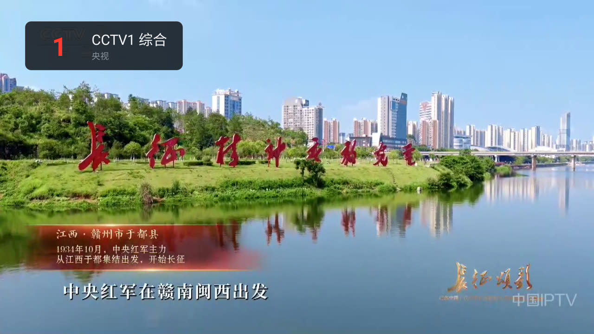

# 轻直播 · LightLive

**安卓电视 / 机顶盒上的极轻量直播播放器** —— 约 100 KB，零第三方依赖，Android 4.4+ 都能装。
支持自定义 M3U 直播源、EPG 节目单、分类频道，遥控器和触摸屏都能用，无广告、不需要账号。

[](https://github.com/mmaotv/cqcuiptv/actions/workflows/android.yml)
[](LICENSE)
[](https://github.com/mmaotv/cqcuiptv/releases/latest)
[](https://www.android.com/)
[](https://github.com/mmaotv/cqcuiptv/releases/latest)



---

## 下载安装

1. 到 [**Releases**](https://github.com/mmaotv/cqcuiptv/releases/latest) 下载 `LightLive-*.apk`；
2. 拷到电视 / 盒子上安装，或者用 adb：

```bash
adb install -r LightLive-*.apk
```

3. 桌面出现 **轻直播**（蓝紫渐变 + 白色电视图标），打开就能看内置频道。

> 包名 `com.miaomiao.qinglive`，**刻意不含 `tv` / `iptv` / `launcher`** —— 部分电视的安装管控会按这些词
> 把 APK 当成「电视应用 / 运营商业务」拦截。装不上时先看 [常见问题](docs/TECH.md#电视上装不上怎么办)。

---

## 功能

| | |
| --- | --- |
| **按台号换台** | 像老电视一样「按 1 就是 CCTV1、按 18 是湖南卫视」，数字键直达 |
| **分类浏览** | 直接读 M3U 的 `group-title`，央视 / 卫视 / 4K / 各地分好类 |
| **EPG 节目单** | 每个频道显示「正在播 / 下一档」，`INFO` 键看当天完整节目表 |
| **自定义源** | 填一个 M3U 地址，或把整段内容直接粘进来，不限内置的那一份 |
| **4K 硬解** | 自研 RTSP → TS → MediaCodec 内核，4K HEVC 也能直接硬解上屏 |
| **遥控器 + 触摸** | 遥控器数字键 / 方向键；平板、触摸大屏单击换台、双击看节目单 |
| **局域网填源** | 手机浏览器打开 `http://盒子IP:8965` 粘贴 M3U，不用拿遥控器打字 |
| **离线可用** | APK 内置一份频道列表，断网、地址失效也能进界面 |
| **应用内更新** | 设置页检查新版本，先看更新日志，你点了才下载安装 |
| **小** | 约 100 KB，不用 AndroidX / ExoPlayer / VLC，老盒子也跑得动 |

### 遥控器按键

| 按键 | 作用 |
| --- | --- |
| `0` – `9` | 输入台号，约 1.1 秒后自动跳转（`1` → CCTV1，`1` `8` → 湖南卫视） |
| `↑` / `↓`、`CH+` / `CH-` | 上一个 / 下一个频道 |
| `←` / `→` | 音量 − / +（节目单打开时是上下换台） |
| `OK` | 打开频道列表；列表里 `→` 进频道栏、`←` 回分类、`OK` 换台 |
| `INFO` | 打开 / 关闭当前频道的节目单 |
| `返回` | 关列表、关节目单；再按退出 |
| `MENU` / 长按 `OK` | 打开设置 |

### 触摸操作（平板 / 触摸大屏）

单击画面**左 1/5** 上一台、**右 1/5** 下一台、**中间**打开频道列表；**双击**看节目单；
左右滑动换台、上下滑动调音量；**长按**进设置。

---

## 换直播源

进设置页（`MENU`）→ 填 M3U 地址，或者把整段 M3U 内容粘进去 → **保存并重载**，立刻生效。

- 取用顺序：**自定义内容** → **本地缓存** → **播放列表地址** → **APK 内置列表**；
- 缓存默认 7 天，可选 15 天 / 一个月 / 不自动，过期先顶上旧列表再后台更新；
- 地址拉不到会自动试 jsDelivr 镜像，还不行就用缓存，不影响继续看。

> 内置的 `cqcu-tv.m3u` 是重庆联通 IPTV 源，**只能在重庆联通网络下播放**，其他网络会黑屏 / 超时 ——
> 这是源的限制，不是 App 的问题。换个自己的源就行。

**不想用遥控器打字**：设置页打开「在手机 / 电脑上填源」，同局域网手机浏览器访问
`http://盒子IP:8965`，粘贴保存，电视端立刻重新加载。

---

## 节目单（EPG）

节目单走外部 XMLTV（默认 [fanmingming/live](https://github.com/fanmingming/live) 的 `e.xml`），
首次后台下载约 9 MB，之后缓存 6 小时。列表第二行显示正在播的节目，`INFO` 看全天节目表。
数据源没收录的台（付费频道、地方台）显示「暂无节目单」，不影响播放。

---

## 版本更新

设置页最下面 → **版本更新**：检查新版本、看更新日志、点「立即更新」才下载安装。
没有自动检查、没有后台下载、没有静默安装。

> 从 3.0.5 及更早版本升级仍需手动装一次（旧版没有这个入口）。

---

## 自己编译

需要 JDK 17+ 和 Android SDK（compileSdk 34）：

```bash
./gradlew assembleRelease
# 产物：app/build/outputs/apk/release/LightLive-<版本>.apk
```

想把自建列表打进包里当默认源：

```bash
./gradlew assembleRelease -PdefaultPlaylist=http://192.168.1.10:8000/my.m3u
```

签名用仓库里的 `keystore/qinglive.jks`（密码 `qinglive`，公开自签名，只为保证版本间能覆盖安装）。
推送到 `main` 后 GitHub Actions 自动构建并更新 `app-latest` Release。

---

## 已知限制

- **内置源只限重庆联通网络**，其他网络放不出来与 App 无关；
- **4K 要看盒子硬解能力**：解不动的机会明确提示「本机 HEVC 硬解最高只到 xxx」，不会黑屏卡死；
  真 4K 需要 S905X3 及以上的芯片；
- 部分固件的 4K HEVC 10bit 硬解有问题（表现为纯绿画面）；
- 音频统一输出双声道，5.1 / 7.1 在软件里降混；
- 没有回看、没有收藏夹 —— 只干一件事：把台放出来、把节目单写清楚。

---

## 更多文档

播放内核实现、踩过的坑、源列表维护、发版流程、安装故障排查：见 **[docs/TECH.md](docs/TECH.md)**。

---

## English

**LightLive** is a tiny (~100 KB, zero third-party dependencies) **Android TV / set-top-box live-TV player**
for **IPTV / M3U playlists**, with XMLTV **EPG**, channel categories, and full remote + touch support.
It ships its own RTSP → MPEG-TS → `MediaCodec` pipeline (HEVC / AVC hardware decode, pure-Java MP2
soft-decode), so it works on boxes where the system player fails.

```bash
./gradlew assembleRelease      # or download the APK from Releases
```

Android 4.4+ (API 19). MIT licensed. See [docs/TECH.md](docs/TECH.md) for internals.

---

## 致谢与许可

- MP2 音频解码移植自 [delthas/JavaMP3](https://github.com/delthas/JavaMP3)（MIT）
- 节目单数据来自 [fanmingming/live](https://github.com/fanmingming/live)
- 可参考的同类项目：[mytv-android](https://github.com/mytv-android/mytv-android)

**MIT 许可证**（见 [LICENSE](LICENSE)）。仅用于学习和个人观看，直播源版权归各电视台所有。

如果这个项目对你有用，欢迎 **Star** ⭐ → <https://github.com/mmaotv/cqcuiptv>
